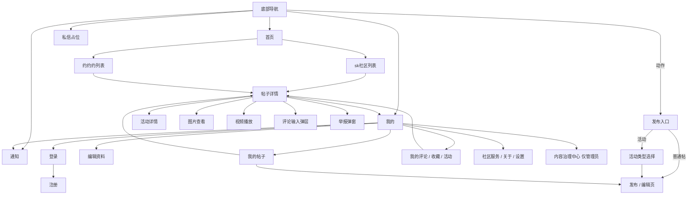

# Skneo（Snow Fish）界面设计任务书

**产品**：滑雪人群 UGC 社区（Flutter Web / PWA，竖屏移动端优先）
**语言**：简体中文
**任务性质**：现有产品的视觉与体验重做，不是从零定义产品
**视觉参考**：Threads 移动端

> 本文档描述产品的**真实结构、字段与状态**。设计必须与文档一致；文档没有的功能不要新增。

---

## 1. 产品是什么

一个面向滑雪爱好者的内容社区，用户在这里：

- 分享滑雪相关的图文动态
- 按地区发起或参加滑雪相关活动（约滑、约拍、约饭、约装备）
- 点赞、收藏、评论、回复
- 举报违规内容，管理员处理举报

每个用户在资料里有**常驻地区**和**常驻雪场**，会作为身份标签展示在昵称旁边。这个标签是"这个人常驻哪里"，不是帖子的发生地点。

产品**没有**：电商、支付、私聊、关注关系、搜索、推荐算法、系统推送。

---

## 2. 设计目标与风格方向

### 目标

1. 内容优先：让文字与图片成为主角，界面元素退到背景里。
2. 信息密度克制：一屏聚焦一条内容，而不是塞满卡片。
3. 中文可读性优先：不要用超细字重，不要用过小的字号。
4. 深浅色两套完整可用。

### 参考 Threads 的什么

- 大量留白、极弱的分割线
- 单一强调色，其余用中性灰阶层
- 头像与昵称的紧凑排布
- 底部导航的克制形态
- 克制的图标风格（线性、细描边）

### 不参考 Threads 的什么

- 不要照搬 Threads 的功能模块（Following 流、转发、引用计数、搜索栏、话题标签）
- 不要用 Threads 的品牌色与 logo

### 滑雪主题的落点

主题应体现在**图片内容与文案**上，不要用大面积的雪山插画、雪花纹理、渐变蓝背景作为界面底板。

---

## 3. 信息架构

### 3.1 底部导航：5 个入口，顺序固定

```text
首页   |   私信   |   发布   |   通知   |   我的
```

关键规则：

- **「发布」是动作按钮，不是可停留的页面 Tab。** 点击后打开新页面，底部导航不应停留在选中状态。
- 「通知」入口需要支持**未读红点 + 数字**，超过 99 显示 `99+`。
- 「私信」当前只有一句占位文案，没有消息列表。
- 未登录点「发布」会先进入登录页。

### 3.2 首页内部：2 个顶部 Tab

```text
sk社区   |   约约约
```

- **sk社区**：全国范围的帖子，按发布时间倒序，管理员置顶内容排在最前。没有地区筛选，没有"推荐/关注/同城"分类。
- **约约约**：按地区浏览的活动列表。默认使用当前用户的常驻地区，用户可以临时切换浏览地区（切换不会修改个人资料）。

两个 Tab 需要**各自保留滚动位置与筛选条件**，来回切换不重置。

---

## 4. 页面清单

共 18 个页面。

| 页面 | 说明 |
|---|---|
| 首页 | 双 Tab 容器 |
| sk社区列表 | 帖子信息流 |
| 约约约列表 | 活动列表 + 地区/类型筛选 |
| 帖子详情 | 图文内容 + 点赞收藏 + 评论区 |
| 活动详情 | 在帖子详情基础上增加活动信息与报名 |
| 发布入口 | 普通帖直接进入表单；活动先选类型 |
| 活动类型选择 | 4 个选项的列表页 |
| 发布 / 编辑页 | 图文表单；活动时增加活动字段 |
| 私信占位 | 单行文案 |
| 通知 | 通知列表 + 全部已读 |
| 我的 | 资料卡 + 功能入口 + 我的动态 |
| 我的帖子 | 列表，可编辑/删除 |
| 我的评论 | 我发表的评论原文列表 |
| 我的收藏 | 我收藏的帖子 |
| 我的活动 | 3 个 Tab：我发起的 / 我参与的 / 已结束 |
| 编辑资料 | 昵称、签名、常驻地区、常驻雪场、头像、背景图 |
| 登录 | 邮箱验证码登录 |
| 注册 | 用户名 + 常驻地区 + 常驻雪场 + 验证码 |
| 图片查看 | 全屏看图，可左右切换 |
| 视频播放 | 全屏播放 |
| 内容治理中心 | 管理员专用，举报列表与处理 |

### 页面跳转关系



---

## 5. 各页面内容与元素

### 5.1 sk社区 · 帖子卡片

卡片必须包含以下元素（排列可调整，元素不可缺）：

```text
头像                     可点击进入作者主页
昵称                     可点击进入作者主页
发布时间                 相对时间，如"3 小时前"
常驻地区 · 雪场           作者资料标签，无资料时整行隐藏
标题
正文                     超过 150 字截断
媒体区
  · 多图时横向滑动，右下角显示"N 图"角标
  · 视频时显示缩略图，中央叠加播放图标
点赞按钮                 红心 + 数量
评论按钮                 气泡图标 + 数量
```

整张卡片可点击进入详情。

**卡片上没有**：分享、更多菜单、收藏、关注、置顶标识。

### 5.2 约约约 · 活动列表

```text
顶部筛选区（两个下拉并排）
  · 浏览地区：北京 / 河北 / 黑龙江 / 吉林 / 辽宁
  · 活动类型：约滑 / 约拍 / 约饭 / 约装备

活动卡片
  · 标题
  · 地区 · 活动状态
```

活动状态共 4 种，需要视觉区分：

```text
招募中   /   已满员   /   已结束   /   已取消
```

### 5.3 帖子详情

```text
顶部栏
  · 返回
  · 标题
  · 举报（所有人可见）
  · 编辑、删除（仅作者本人可见）

正文区
  · 作者行：头像 + 昵称 + 时间 + 地区标签
  · 标题
  · 正文
  · 媒体横滑
      - 图片点击进入全屏查看
      - 视频点击进入播放

操作栏
  · 点赞 + 数量
  · 收藏（两种文案：收藏 / 已收藏）

评论区
  · 标题「评论 (N)」，N 为评论数
  · 单条评论：头像、昵称、时间、内容、赞、回复、更多菜单
      更多菜单项：编辑（仅本人）、删除（仅本人）、举报
  · 回复缩进一层显示

悬浮按钮
  · 写评论
```

### 5.4 活动详情

在帖子详情基础上，正文与操作栏之间插入**活动信息卡**：

```text
状态芯片        招募中 / 已满员 / 已结束 / 已取消
地区 · 雪场
开始时间
报名截止
已报名人数      「已报名 3 / 10 人」，无上限时显示「已报名 3 人」
主按钮
  · 未报名且可报名 → 报名参与
  · 已报名          → 取消报名
  · 我是发起人      → 我发起的活动（禁用）
  · 已满/已截止/已结束 → 当前不可报名（禁用）
```

### 5.5 发布 / 编辑页

普通帖：

```text
媒体选择区      多图预览，可单张移除；未选择时显示"点击选择图片"
已有媒体区      编辑已发布内容时出现，可逐张删除
标题输入        可选
正文输入        必填，4~8 行高度
发布按钮        提交中显示 loading
```

活动发布在此基础上增加 5 个字段：

```text
活动地区        必填
雪场            可选
活动开始时间
报名截止时间
最多参与人数
```

时间字段目前是文本输入（无日期选择器），设计时可以给出更合理的输入控件建议，但字段数量不能减少。

草稿行为：未发布就退出，本次会话内再次进入同一发布入口会恢复已填内容。

### 5.6 我的

```text
资料卡
  · 背景图（高约 150）
  · 圆形头像
  · 昵称
  · 个性签名
  · 常驻地区 · 雪场

入口区（仅本人可见）
  · 编辑资料
  · 我的帖子 / 我的评论 / 我的收藏 / 我的活动
  · 社区服务 / 关于 Snow Fish / 设置
  · 内容治理中心（仅管理员可见）

内容区
  · 「我发布的动态」/「TA 发布的动态」
  · 条目：标题 + 正文摘要 + 右箭头
```

### 5.7 通知

```text
顶部栏        标题 + 「全部已读」
列表项
  · 左侧圆形图标：未读为强调色，已读为灰色
  · 标题：未读加粗，已读常规
  · 正文
  · 有对应内容时显示右箭头
```

### 5.8 我的活动

三个 Tab：

```text
我发起的   |   我参与的   |   已结束
```

条目：标题 + 地区 · 内容摘要。

### 5.9 内容治理中心（仅管理员）

```text
顶部栏        标题 + 版本号（点击展示构建信息）
举报卡片
  · 目标标题（帖子标题 / 评论文本 / 用户昵称）
  · 举报原因
  · 补充说明
  · 内容摘要
  · 操作菜单：置顶 7 天 / 取消置顶 / 确认违规并下架 / 无需处理
```

处理时需要输入处理说明，说明为空会提示。

### 5.10 登录 / 注册

```text
登录：邮箱 → 发送验证码 → 输入 6 位验证码 → 登录
注册：用户名 + 常驻地区（必选）+ 常驻雪场（含"暂无固定雪场"选项）
      → 邮箱 → 验证码 → 注册
```

两个页面都有 60 秒重新发送倒计时。

---

## 6. 必须设计的状态

每个列表页与详情页都要给出全部状态，不能只画正常态。

| 状态 | 出现在哪些页面 |
|---|---|
| 加载中 | 所有列表、详情、资料页 |
| 加载失败 + 重试按钮 | sk社区、通知、我的帖子、我的评论/收藏/活动、活动列表、详情页评论区 |
| 空数据 | 无帖子、无活动、无通知、无收藏、无评论、无动态 |
| 未登录 | 「我的」页显示登录/注册引导；发布动作被拦截 |
| 已登录 | 正常内容 |
| 提交中 / 处理中 | 发布按钮 loading、报名按钮禁用 |
| 操作成功提示 | 点赞、收藏、发布、删除、报名、举报、全部已读 |
| 操作失败提示 | 中文提示文案 |
| 活动不可报名 | 已满 / 已截止 / 已开始 / 已结束 / 自己发起 |
| 未读与已读 | 通知条目两态、底部红点 |
| 图片加载中 / 失败 | 占位块 / 破图占位 |
| 视频条目 | 缩略图 + 播放图标 |

---

## 7. 不可变更的业务约束

1. 「发布」是动作按钮，不是第 6 个 Tab。
2. sk社区与约约约必须并列存在，只有约约约带地区筛选。
3. 地区标签属于**用户资料**，不是内容发生地点。
4. 活动类型固定 4 种：约滑、约拍、约饭、约装备。
5. 活动状态固定 4 种：招募中、已满员、已结束、已取消。
6. 现有功能入口不能删减：点赞、收藏、评论、回复、举报、审核、报名、置顶。
7. 通知必须有「全部已读」。
8. 详情页对作者本人必须同时提供编辑与删除。
9. 所有列表必须支持下拉刷新。

---

## 8. 可以自由设计的范围

- 全部视觉：配色、字体、圆角、间距、阴影、图标、动效
- 帖子卡片的版式与信息排布
- 媒体区形态（只要仍支持多图滑动与视频角标）
- 「我的」入口形态（可从平铺按钮改为宫格或列表）
- 活动信息卡的呈现方式
- 发布页字段排布（字段不可减少）
- 空状态插画、加载骨架、提示条样式
- 底部导航样式与红点表现

---

## 9. 功能可用性说明

设计时请注意哪些入口是真实可用的，避免为占位功能设计复杂界面。

**已实现、可正常使用**

```text
发帖 / 编辑 / 删除
图片与视频上传
点赞、取消点赞
收藏、取消收藏
评论、回复、评论点赞、编辑评论、删除评论
举报帖子 / 评论 / 用户
管理员处理举报、置顶、取消置顶
活动发布、报名、取消报名
通知列表、未读红点、单条已读、全部已读
个人资料编辑（含常驻地区与雪场）
我的帖子 / 我的评论 / 我的收藏 / 我的活动
```

**占位，暂不可用**

```text
私信        仅一句占位文案
社区服务    仅占位说明
设置        仅占位说明
```

**不存在，不要设计入口**

```text
分享、关注/粉丝、搜索、系统推送、商城、订单、支付、聊天
```

---

## 10. 交付要求

### 尺寸

以 390 × 844 为基准画板，同时验证 360 宽小屏与 430 宽大屏不破版。

### 需要交付的内容

1. **设计规范**
   - 主色与语义色（成功 / 警告 / 错误 / 未读）
   - 字体层级（标题 / 正文 / 辅助 / 时间）
   - 间距体系、圆角体系
   - 图标风格
   - 深浅两套颜色

2. **组件库**
   - 帖子卡片、活动卡片
   - 评论项（含回复层级）
   - 操作栏（点赞 / 收藏）
   - 底部导航（含未读红点、中间发布按钮）
   - 筛选器
   - 空状态、加载骨架、提示条
   - 头像 + 地区标签组合
   - 状态芯片（活动 4 种状态）

3. **页面**
   - 按第 4 节清单逐页输出
   - 关键页面附交互说明（点击后发生什么）

### 输出顺序

先出设计规范与组件库，确认后再逐页输出界面。
